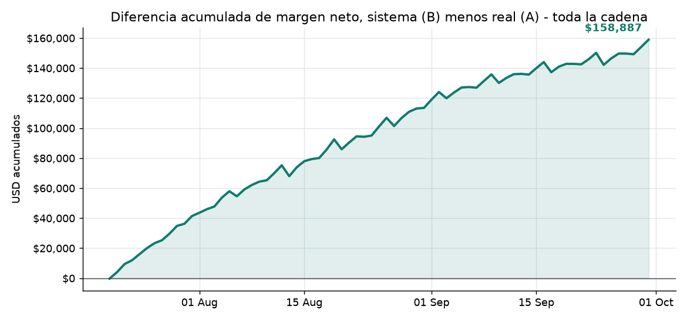
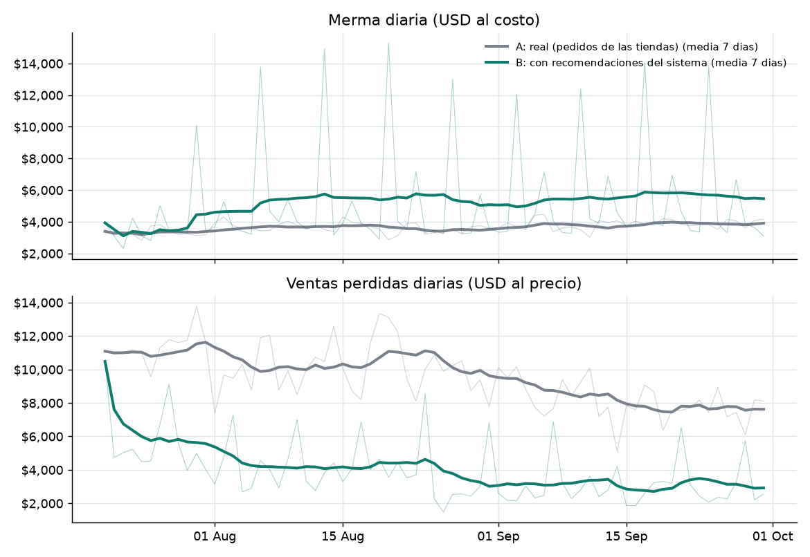
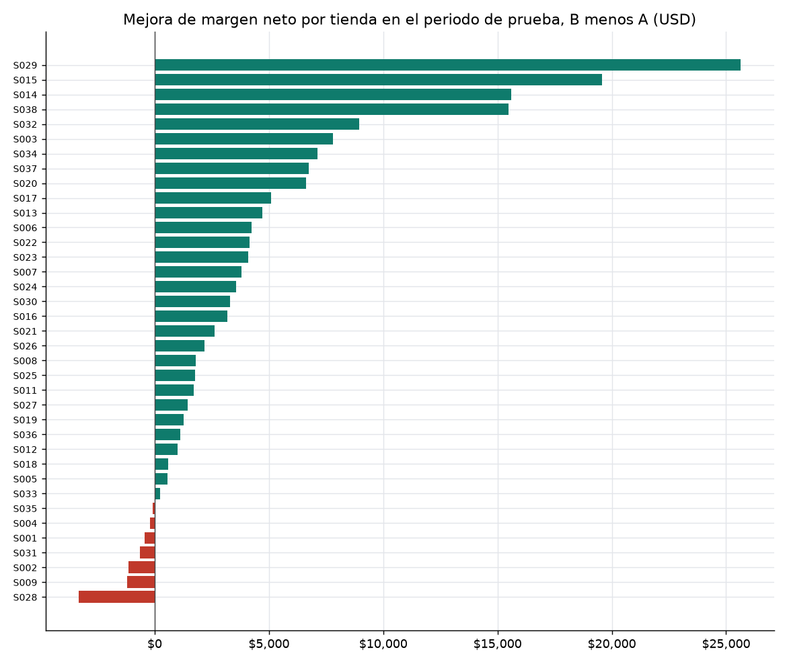
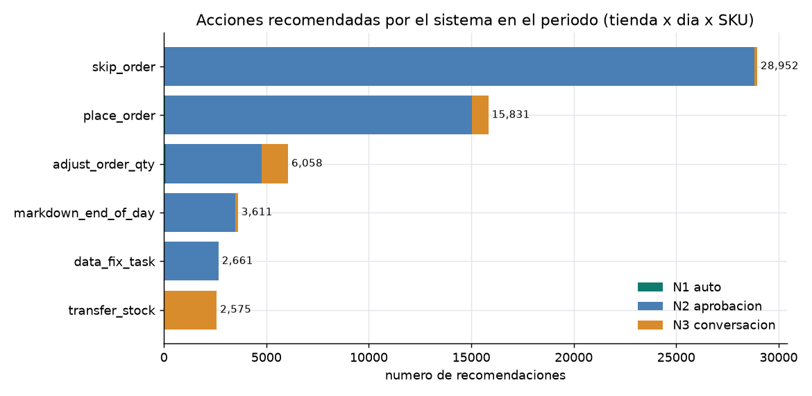
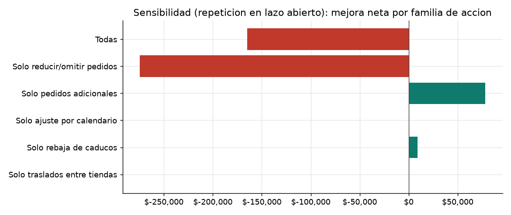

# Contrafactual del periodo de prueba: tiendas reales (A) contra sistema (B)

Periodo de prueba: **2026-07-20 a 2026-09-30** (el ultimo 20 % del dataset; el corte del 80 % es 2026-07-19). 37 tiendas con operacion, 73 dias. Todo en USD. Version 1.

## 1. Resultado

Aplicando la opcion recomendada de cada issue que requiere aprobacion (aprobada en automatico), con el estimado de demanda censurada del backend completo, el margen neto de la cadena pasa de **2 205 766 USD** (A, lo que hicieron las tiendas) a **2 364 652 USD** (B, con el sistema): **+158 887 USD (+7.2 %)**. Intervalo al 95 % por remuestreo de tiendas: +92 875 USD a +237 156 USD.

**Advertencia: la cifra depende del supuesto de demanda en dias con quiebre.** Si solo se cree el 78 % de esa correccion (el nivel consistente con el modelo de ventas perdidas del propio backend) la mejora es +78 415 USD; con 50 % es -47 637 USD; con 0 % (cota inferior: B no puede vender lo que A no registro) -269 462 USD. El punto de equilibrio esta cerca de creer **61 %** de la correccion. Ademas la mejora esta concentrada: el proveedor SUP03 (Summit Frozen Foods (Tue/Fri)) aporta +173 803 USD (109 % del total). Ver secciones 3 y 7.

| Concepto | A real | B sistema | Dif. USD | Dif. % |
|---|---:|---:|---:|---:|
| Ventas | 3,332,204 | 3,786,954 | +454,750 | +13.6 % |
| Ventas perdidas | 691,165 | 286,318 | -404,847 | -58.6 % |
| Merma (al costo) | 267,724 | 375,047 | +107,322 | +40.1 % |
| Compras (al costo) | 1,125,856 | 1,387,209 | +261,353 | +23.2 % |
| Costo de traslados | 0 | 54,278 | +54,278 | n/a |
| Margen bruto | 2,473,490 | 2,793,977 | +320,486 | +13.0 % |
| **Margen neto** | 2,205,766 | 2,364,652 | +158,887 | +7.2 % |
| Flujo de caja | 2,206,348 | 2,345,467 | +139,119 | +6.3 % |

Margen neto = ventas - costo de lo vendido - merma - traslados. Ventas perdidas = demanda no atendida por precio (no entra en el margen: es el dinero que no se vendio). Flujo de caja = ventas - compras - traslados (penaliza el inventario que B termina acumulando).

Lectura honesta: B vende mas y pierde menos ventas, **pero tira mas producto** (merma +40.1 %) y compra mas (+23.2 %). La mejora viene de atender demanda que A perdia por faltantes, no de gastar menos. B cierra el periodo con 24,928 unidades en inventario (34,378 USD al costo) contra 10,499 (14,552 USD) de A.

## 2. Metodo

- **A (linea base)**: lo que el dataset registra. Las recepciones reales de cada tienda y SKU; demanda real de `sales_daily` / `inventory_daily`. Se simula con el mismo motor que B para que la unica diferencia sea la politica. Ajuste del motor contra el dato: unidades vendidas 694,735 simuladas contra 698,868 reales (-0.6 %), caducadas 201,909 contra 197,597 (+2.2 %), merma 267,724 contra 262,197 USD, ventas 3,332,204 contra 3,355,745 USD (`fidelidad_A.csv`).
- **B (sistema)**: lazo cerrado. Cada dia d, para cada tienda abierta, se corre el backend determinista en proceso (`DuckDBMetrics.issues`, as_of = d) y se toma la opcion recomendada de cada issue. Se aprueban todas las que no son `do_nothing` ni N0 (N1, N2 y N3; solo 145 fueron N1). Las decisiones se toman del cierre del 2026-07-19 al 2026-09-29: 93,675 issues, 59,688 recomendaciones accionables. El backend ve **el inventario y los pedidos de B**, no los de A: tablas temporales privadas de la sesion sustituyen `inventory_daily` y `purchase_orders` con las filas que B genero hasta d (el script verifica cada dia que no existe ninguna fila posterior a d). Asi lo que se recomienda manana refleja lo que se hizo hoy.
- **Frecuencia**: decision **diaria para todas las tiendas** (sin muestreo). La calibracion de confianza del backend (solo cambia la etiqueta N1/N2, no la opcion recomendada) se refresca los lunes con datos hasta ese lunes.
- **Como se aplica cada accion**: `skip_order` y `adjust_order_qty` de reduccion cambian el siguiente pedido real de ese SKU (el del dia d+1) a la cantidad recomendada, redondeada a multiplos de caja; el surtido se escala por la tasa de surtido real de ese pedido. `place_order` y `adjust_order_qty` de faltante agregan un pedido que llega en la primera entrega valida del proveedor (plazo medio historico, dias de entrega del proveedor). `transfer_stock` mueve las unidades mas viejas aun vendibles al llegar (1 dia mismo sitio, 2 dias distinto sitio), con el costo fijo + por unidad del backend. `markdown_end_of_day` rebaja 30 % las unidades que de otro modo caducarian ese dia. `calendar_uplift` escala los pedidos de los departamentos afectados. `data_fix_task` no tiene efecto de inventario (se cuenta pero no se simula).
- **Inventario**: lotes FIFO; un lote recibido el dia r se vende hasta r + vida util - 1 y caduca al cierre (misma convencion que el backend; reproduce la caducidad real con +2 %). Inventario inicial = cierre del 19 de julio, repartido en los recibos mas nuevos.
- **Demanda real**: ventas reales. En dias con quiebre la demanda se estima con la correccion de demanda censurada del backend (`metrics.demand.uncensor`), **igual para A y B**.
- **Dinero**: ventas = unidades vendidas x precio neto real del dia (`sales_daily`); costo = `products.unit_cost`.

## 3. Merma y ventas perdidas

La merma de B es +40.1 % respecto de A y tiene picos semanales: el dia de mayor merma de B es el jueves (12,367 USD por dia contra 3,449 en A). Es consistente con SUP03 (26 SKU con 3 dias de vida util y entrega martes y viernes): un pedido mas grande el martes se vende miercoles y jueves y lo que sobra caduca el jueves. Las ventas perdidas de B cambian -59 %.

Por proveedor (B menos A, USD):

| Proveedor (dias de entrega) | Merma | Ventas perdidas | Compras | Margen neto |
|---|---:|---:|---:|---:|
| SUP03 Summit Frozen Foods (Tue/Fri) | +133,821 | -400,095 | +279,482 | +173,803 |
| SUP05 Pioneer Merch & Packaging (Weekly) | +0 | -3,447 | +2,450 | +1,863 |
| SUP06 Evergreen Coffee Roasters (Mon/Thu) | +0 | -6,561 | +2,665 | +5,436 |
| SUP02 Coastal Beverage Distribution (Mon/Thu) | +0 | -6,968 | +3,248 | +5,848 |
| SUP04 Riverbend Fresh & Dairy (Daily) | -2,729 | +5,083 | -3,521 | +409 |
| SUP01 Northfield Bakery Partners (Daily) | -23,770 | +7,141 | -22,971 | +25,806 |

## 4. Por tienda

Mejores 5 tiendas: S029 (+25,644 USD, +14.0 %); S015 (+19,586 USD, +24.8 %); S014 (+15,609 USD, +11.0 %); S038 (+15,468 USD, +16.0 %); S032 (+8,942 USD, +17.4 %).

Peores 5 tiendas: S028 (-3,313 USD, -3.2 %); S009 (-1,192 USD, -1.2 %); S002 (-1,138 USD, -1.9 %); S031 (-658 USD, -1.6 %); S001 (-441 USD, -0.4 %).

**B es peor en 7 de 37 tiendas** (S035, S004, S001, S031, S002, S009, S028): -7 052 USD en conjunto. Tabla completa en `por_tienda.csv`.

## 5. Que acciones recomienda

En el periodo B ejecuto 16,977 lineas de pedido omitidas y 294 reducidas (252,296 de 913,418 unidades pedidas por A, 28 %), 16,739 pedidos adicionales (436,132 unidades), 2,573 traslados (39,219 unidades, 54,278 USD) y rebajas sobre 17,533 unidades.

## 6. Estabilidad en el tiempo

| Semana | Mejora neta | Ventas | Merma | Ventas perdidas | Compras |
|---|---:|---:|---:|---:|---:|
| 2026-07-20 | +23,281 | +40,426 | +1,035 | -34,759 | +16,324 |
| 2026-07-27 | +22,656 | +52,691 | +8,088 | -41,928 | +24,811 |
| 2026-08-03 | +18,371 | +51,851 | +12,381 | -42,175 | +29,218 |
| 2026-08-10 | +15,041 | +47,611 | +12,324 | -42,391 | +26,176 |
| 2026-08-17 | +14,844 | +49,216 | +15,429 | -45,272 | +30,640 |
| 2026-08-24 | +18,825 | +49,858 | +10,997 | -46,764 | +26,744 |
| 2026-08-31 | +14,343 | +42,532 | +10,402 | -39,717 | +22,883 |
| 2026-09-07 | +8,769 | +38,563 | +12,862 | -35,696 | +24,382 |
| 2026-09-14 | +6,631 | +35,299 | +12,922 | -31,868 | +23,420 |
| 2026-09-21 | +6,888 | +34,448 | +12,125 | -32,390 | +21,825 |
| 2026-09-28 | +9,237 | +12,254 | -1,243 | -11,886 | +14,929 |

La mejora semanal baja con el tiempo (primeras semanas contra ultimas): al principio B repone los faltantes acumulados y despues la merma extra se estabiliza. La semana del 28 de septiembre tiene solo 3 dias.

## 7. Sensibilidad y robustez

**Demanda en dias con quiebre.** El mayor supuesto: cuanta de la demanda censurada es real. Se repitio el lazo cerrado completo creyendo solo una parte de la correccion del backend:

| Supuesto | Mejora neta B - A | Ventas perdidas A | Ventas perdidas B | Merma B - A |
|---|---:|---:|---:|---:|
| 100 % de la correccion (cifra principal) | +158,887 | 691,165 | 286,318 | +107,322 |
| 78 % (consistente con el modelo de ventas perdidas del backend) | +78,415 | 540,875 | 240,079 | +110,580 |
| 50 % | -47,637 | 349,269 | 193,476 | +124,286 |
| 0 % (solo ventas observadas; cota inferior) | -269,462 | 9,616 | 130,890 | +148,752 |

El modelo de ventas perdidas del backend (horas de quiebre x tasa horaria de dias sin quiebre x precio de lista) estima 539,207 USD perdidos en A; el estimado de demanda censurada usado aqui da 691,165 USD (78 %). Es la razon del escenario de 78 %.

**Rebajas (elasticidad asumida).** Aportan 49,902 USD de B (17,533 unidades, recuperacion 50 % a -30 %, supuesto propio del backend sin historial). Sin rebajas la mejora seria +108,985 USD.

**Repeticion en lazo abierto (solo informativa).** Aplicar las decisiones del mundo A (sin que el sistema vea sus efectos) con bloqueos para no duplicar una senal persistente da otra cifra, porque una senal que sigue encendida en A llevaria a omitir pedidos dia tras dia:

| Variante | Mejora neta | Merma | Ventas perdidas | Compras |
|---|---:|---:|---:|---:|
| Todas juntas | -164,861 | +21,221 | +168,219 | +31,071 |
| Solo reducir / omitir pedidos | -274,472 | -215,377 | +657,771 | -386,884 |
| Solo pedidos adicionales (riesgo de faltante) | +78,094 | +247,826 | -457,722 | +417,406 |
| Solo ajuste por calendario | +264 | +320 | -822 | +626 |
| Solo rebaja de caducos | +8,773 | -3,428 | +0 | +0 |
| Solo traslados entre tiendas | +656 | -3,109 | -9,925 | +0 |

Lectura: en lazo abierto omitir pedidos cuesta ventas porque el sistema no puede dejar de recomendar omitir; el lazo cerrado corrige eso porque cada dia ve el inventario que dejo. Es el motivo por el que la cifra principal es la de lazo cerrado.

## 8. Supuestos y limites

- Es un periodo de **verano** (julio a septiembre): la estacionalidad, el calendario y los eventos pueden no representar el resto del anio.
- La demanda de los dias con quiebre es **estimada** (demanda censurada del backend, tope p90). La mayor parte de la mejora viene de vender lo que A perdio por faltantes, asi que depende de ese estimado (ver sensibilidad).
- Las recomendaciones se aplican **sin criterio del gerente**: ni rechazos, ni ajustes, ni retrasos en la aprobacion. Un gerente real descartaria algunas (por ejemplo omitir pedidos de SKU con promociones locales).
- No se modela el **minimo de compra por proveedor** (MOV), ni que el proveedor acepte menos de una caja; las cantidades se redondean a cajas.
- Los pedidos adicionales llegan completos y en la primera entrega valida segun el plazo medio historico; no se simula retraso ni surtido parcial.
- El mundo B conserva la secuencia de pedidos reales de cada tienda (cuando y para que SKU piden); solo cambian cantidades o se agregan pedidos.
- Los traslados usan el costo y plazo supuestos del backend; las rebajas, la elasticidad supuesta del backend.
- Mermas por daño (`damaged_qty`, menos del 0.5 % de la merma) se aplican igual en A y B. No se contabiliza el valor del inventario final (se informa aparte) ni el costo de oportunidad del capital.
- No hay efecto de precio ni de elasticidad en el resto del surtido; las promociones, el personal y las correcciones de datos (`data_fix_task`, `run_promo`, turnos) no se simulan.
- El intervalo de confianza solo refleja la variacion entre tiendas, no la incertidumbre de los supuestos anteriores.

## 9. Archivos y como reproducir

- Script (analysis only, removed from the product tree; see git history before the release cleanup, `backend/scripts/holdout_counterfactual.py`) (etapas `decide`, `simulate`, `report`). Tablas: `resumen_total.csv`, `por_tienda.csv`, `serie_diaria.csv`, `acciones_recomendadas.csv`, `fidelidad_A.csv`, `sensibilidad_repetido.csv`.
- Lectura de solo lectura de `data/clean/glazed.duckdb`; no se toca Postgres ni los contenedores.
- Calculo: 34 minutos de CPU sumados en 8 regiones (corre en paralelo por region porque los traslados solo ocurren dentro de una region).
